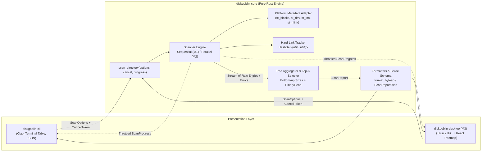

# DiskGoblin — Architecture

## 1. Architectural Philosophy & Design Principles

DiskGoblin's architecture is guided by eight engineering rules established in `PLANNING_CHARTER.md`:

1. **Correctness before optimization:** Establish a deterministic, single-threaded reference scanner (`M1`) before introducing multi-threaded directory traversal (`M2`).
2. **Safety by default:** Strictly read-only filesystem operations (`symlink_metadata` / `read_dir`). No file deletions, mutations, or symlink traversal loops.
3. **Deterministic verification:** Inject filesystem metadata or test against synthetic temporary fixtures (`tempfile`), ensuring identical outputs across runs.
4. **Small, bounded changes:** Decouple metadata extraction, traversal, tree aggregation, ranking, and presentation into narrow modules with explicit Rust types so autonomous coding agents can implement them in isolated PRs.
5. **Explicit interfaces:** `diskgoblin-core` exposes pure data structures and trait/callback boundaries with zero CLI or GUI dependencies.
6. **Observable execution:** Emit structured progress events and structured scan error records rather than printing ad-hoc warnings from inside the engine.
7. **Portable design:** Encapsulate Unix-specific inode/block semantics behind a small `platform` module with clean fallbacks for non-Unix targets.
8. **Minimal complexity:** Start with a 2-crate Cargo workspace (`diskgoblin-core` and `diskgoblin-cli`). Defer `diskgoblin-desktop` until Milestone `M3` so `M0`–`M2` agents are never slowed down by Node/Tauri/WebKit build dependencies.

---

## 2. Workspace & Repository Layout

```text
diskgoblin/
├── Cargo.toml                      # Workspace root (resolver = "2", shared lints & dependencies)
├── AGENTS.md                       # Shared execution contract for OpenCode & Codex agents
├── PLANNING_CHARTER.md             # Project charter
├── crates/
│   ├── diskgoblin-core/            # Pure library crate: domain types, scanner, aggregator, formatting
│   │   ├── Cargo.toml
│   │   ├── src/
│   │   │   ├── lib.rs              # Public API surface & re-exports
│   │   │   ├── config.rs           # ScanOptions, SizeMetric, ThreadMode
│   │   │   ├── model.rs            # DirNode, FileEntry, ScanReport, ScanStats, EntryKind
│   │   │   ├── error.rs            # ScanError, ScanErrorKind, FatalScanError
│   │   │   ├── platform.rs         # OS metadata extraction (blocks, dev, ino, nlink)
│   │   │   ├── cancel.rs           # CancelToken & ProgressSink trait
│   │   │   ├── scanner/
│   │   │   │   ├── mod.rs          # Scanner facade & strategy dispatch
│   │   │   │   ├── sequential.rs   # M1 deterministic single-threaded scanner (walkdir/std::fs)
│   │   │   │   └── parallel.rs     # M2 parallel scanner (jwalk/rayon) verified against sequential
│   │   │   ├── aggregator.rs       # Bottom-up directory rollups, top-K heaps, hardlink dedup
│   │   │   └── format.rs           # Human-readable size formatting (IEC/SI) & JSON schema wrapper
│   │   ├── tests/                  # Integration & property tests using synthetic fixtures
│   │   └── benches/                # Criterion benchmarks (added in M2)
│   └── diskgoblin-cli/             # Binary crate (`diskgoblin` binary)
│       ├── Cargo.toml
│       ├── src/
│       │   ├── main.rs             # CLI entrypoint, SIGINT setup, exit code mapping
│       │   ├── args.rs             # Clap derive CLI definition & validation
│       │   ├── progress.rs         # Throttled stderr TTY progress renderer
│       │   └── render.rs           # Human terminal table renderer & JSON stdout writer
│       └── tests/
│           └── cli_integration.rs  # End-to-end binary execution tests
├── apps/
│   └── diskgoblin-desktop/         # Added in M3: Tauri 2 + React + TypeScript + Vite
├── docs/
│   ├── product-spec.md
│   ├── architecture.md
│   ├── implementation-plan.md
│   ├── testing-strategy.md
│   ├── factory-design.md
│   ├── decisions/                  # Architecture Decision Records (ADR-001 .. ADR-006)
│   ├── experiments/
│   │   └── experiment-plan.md
│   └── backlog/                    # Agent-ready GitHub issue drafts
└── .github/
    └── workflows/
        └── ci.yml                  # fmt, clippy, test on macOS & Ubuntu
```

---

## 3. System Component & Dataflow Architecture



---

## 4. Core Domain Model & Module Contracts (`diskgoblin-core`)

To enable multiple coding agents to work in parallel or sequence without interface drift, `diskgoblin-core` enforces the following explicit types:

### 4.1 Configuration (`config.rs`)

```rust
use std::path::PathBuf;

#[derive(Debug, Clone, Copy, PartialEq, Eq, serde::Serialize, serde::Deserialize)]
#[serde(rename_all = "snake_case")]
pub enum SizeMetric {
    /// Physical disk allocation (blocks * 512 on Unix; fallback to apparent on unsupported OS)
    Allocated,
    /// Logical byte length (`metadata.len()`)
    Apparent,
}

#[derive(Debug, Clone)]
pub struct ScanOptions {
    pub root_path: PathBuf,
    pub size_metric: SizeMetric,
    pub one_file_system: bool,
    pub max_depth: Option<usize>,
    pub top_n: usize,
    pub min_size_bytes: u64,
    pub threads: usize, // 1 = sequential reference scanner; >1 or 0 = parallel scanner (M2)
}
```

### 4.2 Platform Metadata Abstraction (`platform.rs`)

```rust
#[derive(Debug, Clone, Copy, PartialEq, Eq, Hash)]
pub struct FileId {
    pub device_id: u64,
    pub inode: u64,
}

#[derive(Debug, Clone, Copy, PartialEq, Eq)]
pub enum EntryKind {
    File,
    Directory,
    Symlink,
    Other,
}

#[derive(Debug, Clone, Copy, PartialEq, Eq)]
pub struct RawMetadata {
    pub kind: EntryKind,
    pub apparent_size: u64,
    pub allocated_size: u64,
    pub file_id: Option<FileId>,
    pub hard_link_count: u64,
}
```
- **On Unix (`#[cfg(unix)]`):** Uses `std::os::unix::fs::MetadataExt`.
  - `allocated_size = metadata.blocks().saturating_mul(512)`
  - `apparent_size = metadata.len()`
  - `file_id = Some(FileId { device_id: metadata.dev(), inode: metadata.ino() })`
  - `hard_link_count = metadata.nlink()`
- **On Non-Unix (`#[cfg(not(unix))]`):**
  - `allocated_size = metadata.len()`
  - `apparent_size = metadata.len()`
  - `file_id = None`
  - `hard_link_count = 1`

### 4.3 Cancellation & Progress Reporting (`cancel.rs`)

```rust
use std::sync::{
    atomic::{AtomicBool, Ordering},
    Arc,
};

#[derive(Debug, Clone, Default)]
pub struct CancelToken(Arc<AtomicBool>);

impl CancelToken {
    pub fn new() -> Self { Self::default() }
    pub fn cancel(&self) { self.0.store(true, Ordering::Relaxed); }
    pub fn is_cancelled(&self) -> bool { self.0.load(Ordering::Relaxed) }
}

#[derive(Debug, Clone, Copy, PartialEq, Eq, serde::Serialize)]
pub struct ScanProgress {
    pub files_seen: u64,
    pub dirs_seen: u64,
    pub symlinks_seen: u64,
    pub errors_seen: u64,
    pub bytes_accumulated: u64,
    pub elapsed_ms: u64,
}

pub trait ProgressSink: Send + Sync {
    fn on_progress(&self, progress: ScanProgress);
}
```

### 4.4 Error Representation (`error.rs`)

We strictly distinguish **Fatal Scan Errors** (the scan cannot start at all, e.g., root path does not exist or is unreadable) from **Non-Fatal Entry Errors** (a subdirectory or file inside the scan failed `read_dir` or `symlink_metadata`).

```rust
use std::path::PathBuf;

#[derive(Debug, thiserror::Error)]
pub enum FatalScanError {
    #[error("root path does not exist: {path}")]
    RootNotFound { path: PathBuf },
    #[error("failed to read root metadata for {path}: {source}")]
    RootUnreadable { path: PathBuf, #[source] source: std::io::Error },
    #[error("scan cancelled by user")]
    Cancelled,
}

#[derive(Debug, Clone, Copy, PartialEq, Eq, serde::Serialize, serde::Deserialize)]
#[serde(rename_all = "snake_case")]
pub enum ScanErrorKind {
    PermissionDenied,
    NotFound,
    IoError,
}

#[derive(Debug, Clone, PartialEq, Eq, serde::Serialize, serde::Deserialize)]
pub struct ScanErrorRecord {
    pub path: PathBuf,
    pub kind: ScanErrorKind,
    pub message: String,
}
```

### 4.5 Scan Result & Tree Model (`model.rs`)

```rust
use std::path::PathBuf;
use crate::{config::SizeMetric, error::ScanErrorRecord};

#[derive(Debug, Clone, PartialEq, Eq, serde::Serialize, serde::Deserialize)]
pub struct FileEntry {
    pub path: PathBuf,
    pub apparent_size: u64,
    pub allocated_size: u64,
    pub is_deduplicated_hardlink: bool,
}

#[derive(Debug, Clone, PartialEq, Eq, serde::Serialize, serde::Deserialize)]
pub struct DirSummary {
    pub path: PathBuf,
    pub depth: usize,
    pub apparent_size: u64,
    pub allocated_size: u64,
    pub file_count: u64,
    pub dir_count: u64,
    pub symlink_count: u64,
    pub error_count: u64,
}

#[derive(Debug, Clone, PartialEq, Eq, serde::Serialize, serde::Deserialize)]
pub struct DirNode {
    pub summary: DirSummary,
    pub children: Vec<DirNode>,
}

#[derive(Debug, Clone, PartialEq, Eq, serde::Serialize, serde::Deserialize)]
pub struct ScanReport {
    pub schema_version: u32,
    pub root_path: PathBuf,
    pub size_metric: SizeMetric,
    pub duration_ms: u64,
    pub root: DirNode,
    pub top_directories: Vec<DirSummary>,
    pub top_files: Vec<FileEntry>,
    pub errors: Vec<ScanErrorRecord>,
}
```

---

## 5. Resolutions to Key Architectural Questions

Each of the charter's architectural questions is resolved below and documented in dedicated ADRs under `docs/decisions/`:

| Question | Architectural Resolution | Reference |
|---|---|---|
| **1. Workspace structure: Multi-crate vs single crate?** | Start with a **2-crate workspace** (`diskgoblin-core`, `diskgoblin-cli`). Defer `diskgoblin-desktop` until Milestone `M3`. Enforces strict library/CLI separation from day one without premature GUI dependencies. | [ADR-001](decisions/001-workspace-structure.md) |
| **2. Logical vs allocated disk size?** | Track **both** `allocated_size` and `apparent_size` on every node. Default to `SizeMetric::Allocated` on Unix (`blocks * 512`), with `--apparent-size` flag for logical bytes. | [ADR-002](decisions/002-size-metrics-and-hardlinks.md) |
| **3. Hard link counting?** | Deduplicate hard links (`nlink > 1`) per scan using a `(dev, ino)` `HashSet`. Count byte size on first encounter; subsequent links contribute `0` to directory byte rollups and are flagged `is_deduplicated_hardlink: true`. | [ADR-002](decisions/002-size-metrics-and-hardlinks.md) |
| **4. Symlinks & mount boundaries?** | Always use `symlink_metadata` (`lstat`). Never traverse into symlink targets. Support `--one-file-system` (`-x`) by comparing `entry.dev == root.dev`. | [ADR-003](decisions/003-symlinks-mounts-and-errors.md) |
| **5. Partial failure representation?** | Separate `FatalScanError` (root unreadable/cancelled) from `ScanErrorRecord` (child entry unreadable). Roll up `error_count` bottom-up across `DirSummary` nodes so partial subtrees are explicitly flagged. | [ADR-003](decisions/003-symlinks-mounts-and-errors.md) |
| **6. Streaming vs complete result tree?** | Hybrid: stream throttled `ScanProgress` updates via `ProgressSink` during traversal while building an arena/post-order aggregated `ScanReport` (containing bounded-depth `DirNode` tree + bounded `BinaryHeap` top-N files/dirs). | [ADR-004](decisions/004-result-model-and-streaming.md) |
| **7. Parallel traversal vs SSD contention?** | Implement a rock-solid sequential scanner in `M1`. In `M2`, benchmark `jwalk` / bounded `rayon` pools (`1, 2, 4, 8, N` threads) on APFS/NVMe fixtures and only enable parallelism by default if it beats sequential by ≥1.5x without correctness divergence. | [ADR-005](decisions/005-traversal-and-concurrency.md) |
| **8. CLI & Desktop sharing + Visualization?** | `diskgoblin-desktop` (Tauri 2) links `diskgoblin-core` directly as a Rust crate dependency. Tauri commands invoke `scan_directory`, forwarding `ProgressSink` events to Tauri events (`scan:progress`) and returning `ScanReport` JSON to a React + custom SVG/Canvas treemap (or lightweight `@visx/hierarchy` layout). | [ADR-006](decisions/006-desktop-and-visualization.md) |

---

## 6. Performance Targets

| Metric | Target (`M1` Sequential Baseline) | Target (`M2` Optimized / Parallel) |
|---|---|---|
| **Synthetic Fixture (100,000 files, 5,000 dirs, warm cache)** | `< 800 ms` on Apple Silicon macOS | `< 300 ms` on Apple Silicon macOS |
| **Memory Footprint (1,000,000 files, `--max-depth 3`, `--top 20`)** | `< 150 MiB` peak RSS (by not retaining full `FileEntry` structs beyond top-N heap) | `< 150 MiB` peak RSS |
| **Cancellation Latency (`SIGINT` / CancelToken)** | `< 100 ms` to stop traversal | `< 100 ms` to stop all worker threads |
| **Progress Update Overhead** | Throttled to ≤ 20 Hz (`50 ms` minimum interval) | Lock-free atomic counters sampled at ≤ 20 Hz |

### Crucial Memory Optimization: O(D + K) File Retention
A naive scanner stores every `FileEntry` in memory (`O(F)` where `F` can be millions of files), causing multi-gigabyte RAM spikes.
`diskgoblin-core` avoids this:
1. Individual files are **immediately aggregated** into their parent directory's running totals (`allocated_size`, `apparent_size`, `file_count`) and tested against a bounded min-heap of size `K = options.top_n` (`BinaryHeap<Reverse<RankedFile>>`).
2. Only directory nodes (`O(D)`) and the top `K` largest files (`O(K)`) are retained in memory.
3. For deterministic tie-breaking, when two files or directories have equal byte size, they are ordered lexicographically by `path` ascending.
