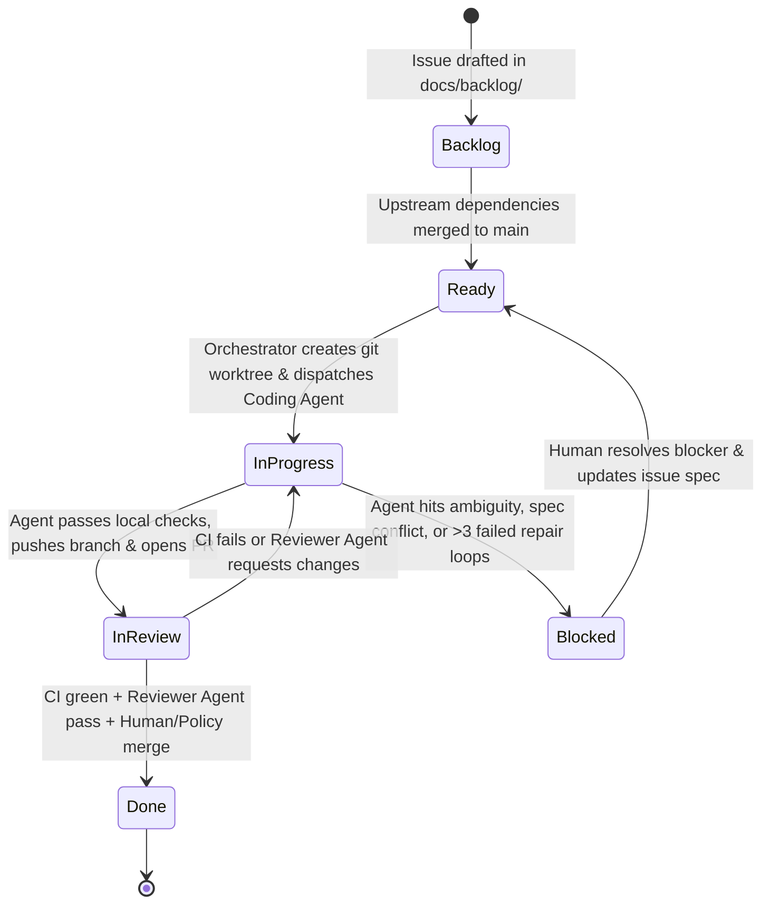

# DiskGoblin — Autonomous Software Factory Design

## 1. Overview & Objectives

DiskGoblin operates as an **AI-Assisted Software Factory** where autonomous coding agents (**OpenCode** and **Codex CLI**) consume bounded specifications from GitHub Issues, implement and verify solutions in isolated Git worktrees, submit pull requests, undergo independent agent + CI review, and record structured telemetry for empirical evaluation.

The factory is designed around a core invariant:
> **The GitHub issue, repository files (`docs/`, `AGENTS.md`), and Git commit history are the sole authoritative state.** Conversational memory inside an agent session is ephemeral and never trusted across tasks.

---

## 2. End-to-End Task Lifecycle & State Machine



### State Transition Rules

| From State | To State | Trigger & Required Preconditions | Actor |
|---|---|---|---|
| **Backlog** | **Ready** | All issues listed in `Dependencies` are in `Done` (`merged` on `main`). | Orchestrator / TPM |
| **Ready** | **In Progress** | Dedicated worktree created from latest `origin/main` (`git worktree add ../diskgoblin-wt-DG-XXX -b feat/DG-XXX-<slug> origin/main`). Agent invoked with issue prompt. | Orchestrator / Coding Agent |
| **In Progress** | **In Review** | `cargo fmt --check`, `cargo clippy -- -D warnings`, and `cargo test` pass locally; PR opened linking `Closes #XX`; structured agent run report posted to PR body. | Coding Agent |
| **In Progress** | **Blocked** | Agent encounters an undocumented requirement ambiguity, needs an unapproved crate dependency, or fails 3 consecutive test/lint repair cycles. Agent posts a `BLOCKER REPORT` comment and applies label `status:blocked`. | Coding Agent |
| **In Review** | **In Progress** | GitHub Actions CI fails (`macos-latest` or `ubuntu-latest`) or independent Reviewer Agent flags a contract violation / missing acceptance criterion. | CI / Reviewer Agent |
| **In Review** | **Done** | All CI checks pass, Reviewer Agent approves, and Human Owner (or authorized merge policy) squash-merges PR to `main`. Worktree is pruned. | Human Owner |

---

## 3. Git Worktree Isolation Protocol

To enable parallel agent execution without workspace collisions or Cargo build-cache corruption:

1. **One Worktree per Active Issue:**
   ```bash
   git fetch origin main
   git worktree add ../worktrees/DG-004-byte-formatting -b feat/DG-004-byte-formatting origin/main
   ```
2. **Branch Naming Convention:**
   - Features: `feat/DG-XXX-<short-slug>`
   - Chores / Tests: `chore/DG-XXX-<short-slug>`
   - Bugfixes: `fix/DG-XXX-<short-slug>`
   - Experiments (paired model runs): `exp/<run-id>/DG-XXX-<harness>-<model>`
3. **Scope Containment:**
   Each issue explicitly specifies allowed files/crates under `## Scope` and forbidden areas under `## Out of scope`. The Reviewer Agent and CI verify via `git diff --name-only origin/main...HEAD` that no out-of-scope files were mutated.

---

## 4. Permission Model & Safety Guardrails

| Capability | Coding Agent Permission | Enforcement Mechanism |
|---|---|---|
| Read repository files & docs | **Allowed** | Sandboxed to worktree directory |
| Edit source & test files within issue scope | **Allowed** | Verified against issue `Scope` in PR review |
| Run `cargo fmt`, `cargo clippy`, `cargo test`, `cargo bench` | **Allowed** | Local shell execution inside worktree |
| Add new crate dependencies to `Cargo.toml` | **Restricted** | Allowed **only** if explicitly authorized in the issue spec; otherwise must escalate as `Blocked` |
| Modify `.github/workflows/` | **Restricted** | Forbidden except in CI-specific issues (`DG-001`, `DG-014`) |
| Push feature branch & open Pull Request (`gh pr create`) | **Allowed** | Branch protection prevents pushing to `main` |
| Merge Pull Request (`gh pr merge`) | **Forbidden** | Agents must **never** merge their own PRs; enforced by `AGENTS.md` and GitHub branch protection |
| Destructive host commands (`rm -rf ~`, `sudo`, network exfiltration) | **Forbidden** | Harness sandbox policies (`codex --sandbox workspace-write`, OpenCode permissions) |

---

## 5. Independent Agent Code Review Protocol

Before requesting human attention on a Pull Request, an **Independent Reviewer Agent** (running in a clean context window, ideally using a distinct model family or fresh session with zero shared memory from the Coding Agent) evaluates the PR against a deterministic checklist:

1. **Spec Compliance:** Is every checkbox in the issue's `## Acceptance criteria` implemented and covered by a test?
2. **Scope Discipline:** Did the PR touch any files outside the issue's `## Scope` or add unapproved dependencies in `Cargo.lock`?
3. **Architecture Contract Adherence:** Does `diskgoblin-core` remain free of CLI/UI dependencies? Are errors properly typed (`thiserror`) without `.unwrap()` / `.expect()` in library production paths?
4. **Test Quality:** Do tests use synthetic `tempfile` fixtures rather than scanning the host filesystem? Are edge cases tested?
5. **Structured Review Output:** The Reviewer Agent posts a GitHub PR review comment classifying findings as:
   - `[BLOCKING]` — Must be fixed before merge (contract violation, missing test, bug, panic risk).
   - `[NON-BLOCKING]` — Minor style or documentation nit.
   - `VERDICT: APPROVE` or `VERDICT: REQUEST_CHANGES`.

---

## 6. Failure Handling & Escalation Policy

1. **Test/Compile Repair Loop Cap (Max 3 Retries):**
   If a coding agent's implementation fails `cargo test` or `cargo clippy`, it may perform up to **3 diagnostic-and-repair iterations**. If the check still fails after 3 attempts, the agent must commit its work-in-progress to the feature branch, open a draft PR, post the failure log, and transition the issue to `Blocked`.
2. **Ambiguity Escalation over Silent Invention:**
   If an issue specification contradicts `docs/architecture.md` or omits a required behavior, the agent must **not** guess silently. It must document the ambiguity in the PR/issue comment and request clarification.
3. **Rate Limits & Subscription Quota Exhaustion:**
   When a harness hits a provider rate limit (`429`) or subscription window cap, the runner script records a `rate_limit_event` with pause duration in the run telemetry JSON so wall-clock active coding time is separated from provider cooldown wait time.
