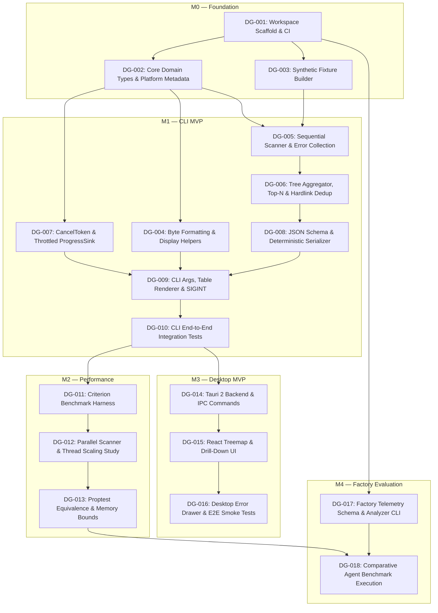

# DiskGoblin — Implementation Plan

## 1. Delivery Strategy & Milestones

Work is decomposed into **18 bounded, independently verifiable tasks** across 5 milestones (`M0`–`M4`). Every task is sized so an autonomous coding agent (OpenCode or Codex) can complete implementation, unit/integration testing, formatting, and linting in **30–120 minutes** within a single focused pull request.

| Milestone | Name | Objective | Issues |
|---|---|---|---|
| **M0** | **Foundation** | Initialize Cargo workspace, CI pipeline, core domain contracts, and synthetic filesystem fixture builder. | `DG-001` – `DG-003` |
| **M1** | **CLI MVP** | Deliver a complete, deterministic sequential disk analyzer CLI with hard-link deduplication, symlink/mount safety, progress/cancellation, human tables, and JSON output. | `DG-004` – `DG-010` |
| **M2** | **Performance** | Build Criterion benchmark suite, evaluate & implement parallel directory traversal (`jwalk`/`rayon`), and enforce sequential-parallel equivalence via property tests. | `DG-011` – `DG-013` |
| **M3** | **Desktop MVP** | Deliver Tauri 2 desktop application sharing `diskgoblin-core`, with interactive `d3-hierarchy` treemap, drill-down breadcrumbs, and top lists. | `DG-014` – `DG-016` |
| **M4** | **Factory Evaluation** | Implement automated telemetry/metrics aggregator and conduct controlled comparative experiments across agents/models. | `DG-017` – `DG-018` |

---

## 2. Dependency Graph & Critical Path

### Critical Path to CLI MVP (`M0` -> `M1`)
`DG-001` → `DG-002` → `DG-005` → `DG-006` → `DG-008` → `DG-009` → `DG-010` (7 sequential steps).

### Parallel Execution Opportunities for Multi-Agent Worktrees
Once `DG-002` merges, up to **4 coding agents can work concurrently** in isolated Git worktrees without merge conflicts:
- **Agent Worktree A:** `DG-003` (Synthetic fixture builder in `crates/diskgoblin-core/src/test_utils.rs` or `tests/common`)
- **Agent Worktree B:** `DG-004` (Size formatting utilities in `crates/diskgoblin-core/src/format.rs`)
- **Agent Worktree C:** `DG-007` (Cancellation token & progress sink in `crates/diskgoblin-core/src/cancel.rs`)
- **Agent Worktree D:** `DG-017` (Factory telemetry scripts/schema in `docs/experiments/` — independent of scanner code)

Similarly, after `DG-010` (CLI MVP completion), **Milestone `M2` (Performance)** and **Milestone `M3` (Desktop MVP)** can execute in parallel across separate worktrees.

---

## 3. Master Backlog Table

| ID | Title | Milestone | Type | Priority | Est. Complexity | Risk | Dependencies | Draft Spec File |
|---|---|---|---|---|---|---|---|---|
| **DG-001** | Initialize Cargo workspace, crates, lint rules, and GitHub Actions CI | M0 | chore | P0 | S (30–45m) | Low | None | [DG-001](backlog/DG-001-workspace-and-ci.md) |
| **DG-002** | Implement core domain models, error types, and platform metadata adapter | M0 | feature | P0 | M (45–75m) | Low | `DG-001` | [DG-002](backlog/DG-002-core-domain-and-platform.md) |
| **DG-003** | Build deterministic synthetic filesystem fixture generator for tests | M0 | feature | P0 | M (45–75m) | Low | `DG-001` | [DG-003](backlog/DG-003-synthetic-test-fixtures.md) |
| **DG-004** | Implement human-readable byte formatting (IEC binary & SI decimal) | M1 | feature | P1 | S (30–45m) | Low | `DG-002` | [DG-004](backlog/DG-004-byte-formatting.md) |
| **DG-005** | Implement sequential directory traversal with symlink, mount, and error handling | M1 | feature | P0 | L (60–90m) | Med | `DG-002`, `DG-003` | [DG-005](backlog/DG-005-sequential-scanner.md) |
| **DG-006** | Implement bottom-up directory aggregation, hard-link deduplication, and top-N selection | M1 | feature | P0 | L (60–90m) | Med | `DG-005` | [DG-006](backlog/DG-006-tree-aggregation-and-hardlinks.md) |
| **DG-007** | Implement cooperative cancellation token and throttled progress reporting | M1 | feature | P1 | M (45–60m) | Low | `DG-002`, `DG-005` | [DG-007](backlog/DG-007-cancellation-and-progress.md) |
| **DG-008** | Implement versioned JSON output schema and deterministic serialization | M1 | feature | P1 | S (30–60m) | Low | `DG-006` | [DG-008](backlog/DG-008-json-serialization.md) |
| **DG-009** | Implement `diskgoblin-cli` argument parser, terminal table renderer, and SIGINT handler | M1 | feature | P0 | M (60–90m) | Low | `DG-004`, `DG-007`, `DG-008` | [DG-009](backlog/DG-009-cli-interface-and-renderer.md) |
| **DG-010** | Add end-to-end CLI integration test suite and exit-code verification | M1 | chore | P0 | M (45–75m) | Low | `DG-009` | [DG-010](backlog/DG-010-cli-integration-tests.md) |
| **DG-011** | Create Criterion benchmark suite with synthetic directory topologies | M2 | research | P1 | M (45–75m) | Low | `DG-010` | [DG-011](backlog/DG-011-criterion-benchmarks.md) |
| **DG-012** | Implement parallel traversal engine and evaluate SSD thread scaling | M2 | feature | P1 | L (75–120m) | High | `DG-011` | [DG-012](backlog/DG-012-parallel-scanner.md) |
| **DG-013** | Add property-based equivalence tests (sequential vs. parallel) and memory regression checks | M2 | chore | P1 | M (45–75m) | Med | `DG-012` | [DG-013](backlog/DG-013-proptest-and-equivalence.md) |
| **DG-014** | Scaffold Tauri 2 desktop app (`diskgoblin-desktop`) and Rust IPC commands | M3 | feature | P2 | L (60–100m) | Med | `DG-010` | [DG-014](backlog/DG-014-tauri-desktop-backend.md) |
| **DG-015** | Implement React + `d3-hierarchy` interactive treemap and breadcrumb drill-down | M3 | feature | P2 | L (75–120m) | Med | `DG-014` | [DG-015](backlog/DG-015-desktop-treemap-ui.md) |
| **DG-016** | Add desktop top-items table, error drawer, and Vitest UI component tests | M3 | feature | P2 | M (60–90m) | Low | `DG-015` | [DG-016](backlog/DG-016-desktop-tables-and-tests.md) |
| **DG-017** | Implement software factory run-log schema, validator, and metrics summary tool | M4 | experiment | P1 | M (45–75m) | Low | `DG-001` | [DG-017](backlog/DG-017-factory-telemetry-tooling.md) |
| **DG-018** | Execute paired model/harness comparison study on benchmark tasks and publish findings | M4 | experiment | P2 | L (90–120m) | Med | `DG-013`, `DG-017` | [DG-018](backlog/DG-018-factory-comparative-study.md) |

---

## 4. Recommended GitHub Project & Repository Configuration

When human approval is granted to configure GitHub (`RimCorp/DiskGoblin`), apply the following setup:

### 4.1 Project Board Columns (Status Field)
1. **Backlog:** Approved issues waiting for upstream dependencies to merge.
2. **Ready:** All dependencies satisfied (`Done`); specification verified; ready for autonomous agent assignment.
3. **In Progress:** Assigned to an active agent worktree (`agent/<issue-id>-<slug>`).
4. **In Review:** PR opened; CI passing; awaiting automated reviewer agent and/or human approval.
5. **Blocked:** Agent encountered an ambiguity, environment blocker, or failing upstream contract requiring human triage.
6. **Done:** PR merged to `main` and issue closed.

### 4.2 Custom GitHub Project Fields
- **Type** (Single Select): `feature`, `bug`, `chore`, `research`, `experiment`
- **Priority** (Single Select): `P0 - Critical Path`, `P1 - High`, `P2 - Normal`
- **Milestone** (Milestone): `M0 — Foundation`, `M1 — CLI MVP`, `M2 — Performance`, `M3 — Desktop MVP`, `M4 — Factory Evaluation`
- **Complexity** (Single Select): `S (30-45m)`, `M (45-75m)`, `L (75-120m)`
- **Risk** (Single Select): `Low`, `Medium`, `High`
- **Dependencies** (Text): Comma-separated blocking issue IDs (e.g., `DG-002, DG-003`)
- **Agent Harness** (Single Select): `OpenCode`, `Codex CLI`, `Human`
- **Model** (Text): e.g., `gpt-5-codex`, `claude-sonnet-4`, `gemini-2.5-pro`

### 4.3 GitHub Labels
- `type:feature`, `type:bug`, `type:chore`, `type:research`, `type:experiment`
- `priority:P0`, `priority:P1`, `priority:P2`
- `risk:low`, `risk:medium`, `risk:high`
- `status:ready`, `status:blocked`, `agent:escalated`

### 4.4 Recommended Project Views
- **1. Agent Dispatch Queue (Table View):** Filtered by `Status == Ready`, sorted by `Priority` asc then `ID` asc.
- **2. Milestone Kanban (Board View):** Grouped by `Status`, sub-grouped by `Milestone`.
- **3. Factory Experiment Tracker (Table View):** Filtered by `Agent Harness != empty`, displaying `Model`, `Complexity`, `Risk`, and linked PR.
